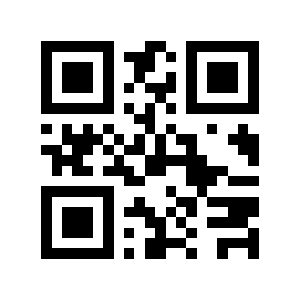
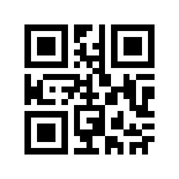

# Function Junction — printable physical-card QR labels

Generated by `npm run generate:physical-qr`. These 13 QR codes identify ranks only: Ace, 2–10, Jack, Queen and King. No suits and no Joker.

The QR payload is a card token, NOT a website link. It contains no IP address, port, session, turn or suit. Use the Scan card button inside the game website, not a separate phone's Camera app.

## Before printing

- Test a label with the website's Scan card button on the device where you play.
- Browser camera access requires HTTPS or localhost. Allow camera permission when prompted.
- No separate mobile connection or shared Wi-Fi setup is needed. The game website must still be running.
- Preview this Markdown with its `qr-codes/` folder, or open `physical-card-qr-codes.html` for the print layout.
- Print black-on-white at 100% scale. Each QR should be at least 30 mm square; preserve the white border.
- Attach the same rank label to all real cards of that rank, regardless of suit. Print extra copies as needed.
- The labels stay valid if the website's address changes, provided its card tokens stay the same.

## Play with real cards

1. The lecturer creates a game and chooses **Physical cards**. Students join normally.
2. Shuffle the real 52-card deck, deal five real cards to each player, and keep the digital board open.
3. On your turn, click Scan card in the game website and allow this device's camera.
4. Hold the printed card label in front of the camera. The camera closes and the Python question appears on the SAME screen.
5. Answer once, complete one move/discard on the digital board, and discard the real card.
6. Every five rounds, shuffle the full real deck and deal five new real cards to each player.

The same rank can be played on later turns, including within the same deal. Each turn permits only one card, one answer and one move/discard. A correct repeated question can earn points again on a later turn. The lecturer supervises real dealing and ownership; a rank-only QR cannot identify an individual physical card.

Digital-card mode remains available and opens questions directly, without generating or scanning QR codes.

## Labels

| Card rank | Printable QR | Encoded token |
| --- | --- | --- |
| Ace |  | `FJ-ACE-2M6R5T` |
| 2 |  | `FJ-TWO-7K3R9M` |
| 3 |  | `FJ-THREE-4P8M2L` |
| 4 |  | `FJ-FOUR-1D9K7P` |
| 5 |  | `FJ-FIVE-8W6T3M` |
| 6 |  | `FJ-SIX-9D2L6W` |
| 7 |  | `FJ-SEVEN-5R2N4X` |
| 8 |  | `FJ-EIGHT-5W1K8P` |
| 9 |  | `FJ-NINE-3M7T4R` |
| 10 |  | `FJ-TEN-3K8P1Q` |
| Jack |  | `FJ-JACK-4X9K2M` |
| Queen |  | `FJ-QUEEN-6L2R9X` |
| King |  | `FJ-KING-7Q3W8D` |
